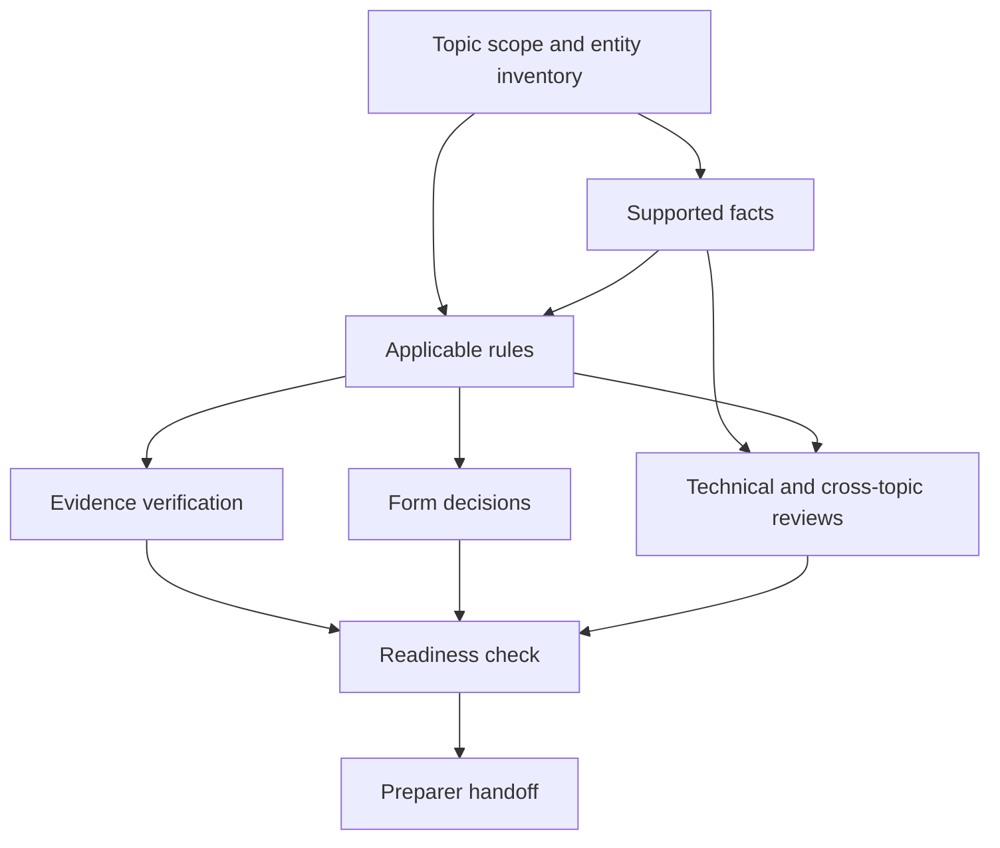

# Taxprep Agent CLI

A noninteractive command-line interface for the 2025 tax intake questionnaire, evidence workflow, and preparer handoff in the supplied tax preparation package. An agent can discover its next task, record supported facts, track evidence and decisions, and resume from a durable case revision.

Built with Python 3.10+, [`argparse`](https://docs.python.org/3/library/argparse.html), and SQLite. This standard-library framework keeps installation simple, makes command parsing deterministic, and provides transactions without a service or runtime dependencies. The repository includes source, the bundled catalog, and a build script for a standalone `taxprep.pyz` executable.

## Dependency graph

> **Illustrative purposes only.** This project and diagram are educational examples, not tax, legal, or financial advice. They may be incomplete or outdated. Verify applicable requirements using current official guidance and consult a qualified tax professional before relying on any output.

Illustrative view of the dependencies evaluated within one case revision. Each box groups related work; arrows lead from supporting context to downstream requirements.



Unknown answers keep work open. Changed facts or replaced sources can invalidate earlier verification and decisions, requiring fresh review. A handoff preserves remaining open items; the highest readiness state is `READY_FOR_PREPARER_REVIEW`.

The full reference catalog is in [`taxprep/catalog.json`](taxprep/catalog.json).

## Quickstart

From a clone of this repository:

```bash
python3 -m taxprep doctor
python3 -m taxprep --db demo.sqlite init --case-id demo-2025 --actor demo-agent
python3 -m taxprep --db demo.sqlite apply --input examples/bootstrap.json --expect 1 --request-id bootstrap-1 --actor demo-agent
python3 -m taxprep --db demo.sqlite next --limit 5
python3 -m taxprep schema
python3 -m taxprep --db demo.sqlite export --output demo-case.json
python3 -m taxprep --db demo.sqlite handoff --output demo-handoff
```

The bootstrap is explicitly fictional. It records a sample taxpayer, employer, year, and confirmed sample rosters; it intentionally leaves the remaining work open. Use a separate database for real work. `--db` must precede the subcommand.

For an installed command, run `python3 -m pip install .`, then use `taxprep`. To build a standalone executable, run `python3 build_release.py` and use `python3 taxprep.pyz` in place of `python3 -m taxprep`. The standalone executable requires no installation or package downloads; the optional pip route requires setuptools to build the package.

## Agent workflow

1. Run `next` to get prioritized tasks with search suggestions and acceptance criteria. Use `inspect TASK_KEY`, `questions`, and `catalog` for detail.
2. Retrieve evidence through the host agent's authorized tools. The CLI itself makes no external calls.
3. Build a JSON operation batch using `schema`. Keep source references with facts, searches, evidence, and decisions.
4. Run `apply` with the last observed revision, a stable request ID, and the actor label. Use `--dry-run` to validate first. A failed batch commits nothing.
5. Re-read `next` after changes. Use current task fingerprints when verifying evidence or closing decisions.
6. Run `check`, then `handoff --output NEW_DIRECTORY` to export the case, evaluated report, open items, task queue, and checksum manifest.

Read [AGENTS.md](AGENTS.md) for the operating rules and [docs/CLI_CONTRACT.md](docs/CLI_CONTRACT.md) for commands, payloads, output, and exit codes. `schema --target protocol` provides the protocol contract as JSON.

## Persistence and compatibility

Each database contains one case and full revision snapshots. Writes use SQLite transactions, expected revisions, and request IDs. A matching retry returns its earlier committed result; a reused ID with different content or actor is rejected. Catalog checksums prevent silently evaluating a case against a different catalog. Existing database and export paths are never overwritten by initialization or export.

On POSIX systems, database files and existing SQLite sidecars are restricted to their owner. Case data and exports remain unencrypted local files. Actor labels are self-declared audit attribution, not authentication; snapshot checksums detect inconsistent data but are not a tamper-proof audit service.

Existing workbench case JSON can be imported into a new database:

```bash
python3 -m taxprep --db imported.sqlite import-case --input case.json --actor intake-agent
```

Imports undergo case validation. Malformed legacy records are rejected; incomplete review records remain open. Import preserves existing facts and does not independently verify their provenance. `export` produces workbench-compatible case JSON; that JSON contains the current case and its case audit, while the SQLite database also retains full earlier snapshots and request history. Keep the database when those histories matter.

## Scope and source

The base reference catalog comes from `Tax_Preparation_Complete_Package_2025.zip`; version 0.1.1 adds an explicit document task when a digital-asset issuer form is known to exist. [SOURCE_PROVENANCE.json](SOURCE_PROVENANCE.json) records source and catalog hashes. This conversion adds an agent protocol, validated mutations, transactional persistence, and review invalidation. It does not independently revalidate tax law, calculate tax, complete return forms, or file anything. Its highest readiness state is `READY_FOR_PREPARER_REVIEW`.

[docs/source](docs/source) preserves the original reference documents. Their descriptions of the prototype's storage and operating commands are historical: this CLI adds SQLite persistence, revision checks, atomic batches, and strict mutations. Follow the root agent guide and CLI contract when operating this implementation. The inherited content-fingerprint model still requires explicit `source_change` operations when source material changes without an accompanying fact change.

No license was supplied for the original package; this repository does not assign one to that material.

## Development

```bash
python3 -m unittest discover -s tests -v
```

Runtime code and catalog are in `taxprep/`; tests are in `tests/`. A build script and test results are included in this repository.
